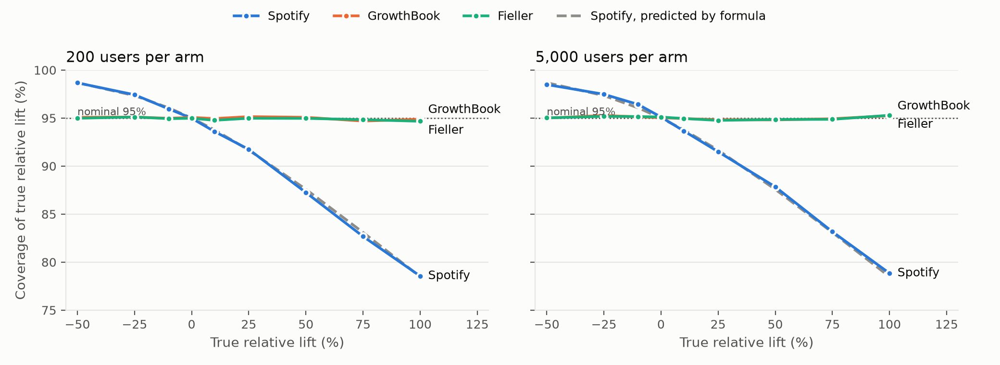
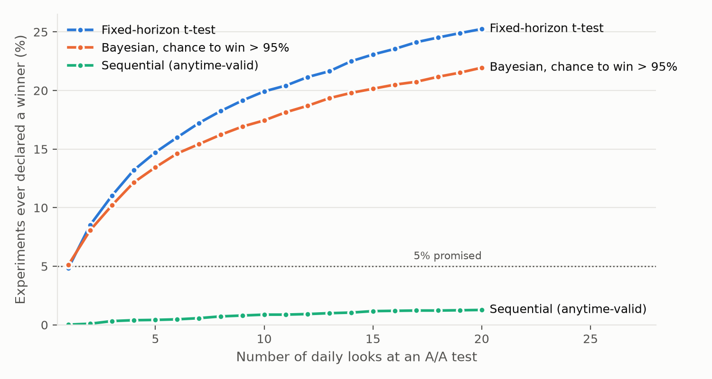

# typeone

**An independent, simulation-based audit of the statistics inside two open-source experimentation engines: [GrowthBook](https://github.com/growthbook/growthbook/tree/main/packages/stats) (`gbstats`) and [Spotify's `confidence`](https://github.com/spotify/confidence).**

A/B-testing tools promise that "95% confidence" means 95% and "p < 0.05" means a 5% false-positive rate. typeone checks that promise. It simulates hundreds of thousands of experiments where the true effect is known, runs each one through each engine's public API, and counts how often the engine is wrong, with Monte Carlo error bars on every number.

## Findings

**1. GrowthBook's relative-lift test is biased by direction on skewed or low-count metrics.** Relative lift is GrowthBook's default view.

On the same simulated data, GrowthBook's *absolute* test is well calibrated, but its *relative* (delta-method) test is not:

| Metric (users per arm) | A/A false positives | …of which false "losers" | Real lift: winner detected | Real lift: **wrong direction** |
|---|---|---|---|---|
| Revenue, 5% buyers (2,000) | **10.1%** (absolute: 4.1%) | 9.7% | 1.8% (absolute: 6.6%) | **3.1%** |
| Revenue, 5% buyers (5,000) | **6.9%** | 6.1% | 4.9% (absolute: 10.7%) | 1.4% |
| Conversion 0.5% (2,000) | **8.8%** | 8.8% (0.00% false winners) | **0.0%** (absolute: 9.4%) | 2.1% |
| Conversion 0.5% (10,000) | 5.5% | 5.0% | 14.5% (absolute: 29.7%) | 0.1% |

With a true +30% lift on a 0.5% conversion rate and 2,000 users per arm, the relative test never declared a winner in 6,000 experiments, but called the treatment a loser 2.1% of the time. With a true +20% revenue lift at 2,000 users per arm, it pointed the wrong way more often than the right way. The bias fades only slowly: at 50,000 users per arm, revenue still shows 5.5% false positives, nearly two-thirds of them "losers".

*Why:* for conversion rates the delta-method statistic is, to a very good approximation at low rates, **z_rel ≈ z_abs · √(p̂_A / p̂_B)**. It is exact as the rates go to zero: at 0.5% the ratio is 0.8163 vs 0.8165; at 30% vs 40% it is 0.857 vs 0.866. When the treatment *looks* better, z shrinks and real winners are missed. When it looks worse, z grows and false losers appear. GrowthBook's Bayesian engine inherits the same behaviour in relative mode: under a true +50% lift it reports "chance to win > 95%" in 0.7% of experiments, against 26% in absolute mode.

**2. Spotify `confidence`'s relative intervals under-cover whenever there is a real effect, and more data doesn't fix it.**

Spotify computes the relative interval as the absolute interval divided by the control mean ([source](https://github.com/spotify/confidence/blob/master/spotify_confidence/analysis/frequentist/confidence_computers/confidence_computer.py)), so the control mean is treated as known. For a true lift r, the coverage this implies is:

    coverage(r) = 2·Φ( 1.96 · √(2 / (1 + (1+r)²)) ) − 1

The formula has no sample size in it. Simulations match it to within half a percentage point at both 200 and 5,000 users per arm: 93.7% at +10%, 91.5% at +25%, 87.8% at +50% and 78.8% at +100%. Negative lifts over-cover instead.



**3. The fix exists, and it's 1950s statistics.** A **Fieller** interval for the ratio of means fixes both problems. Its test of "no effect" is algebraically identical to the absolute-difference test, so its decisions are calibrated: 4.3–5.4% false positives in every scenario. Its interval covers the true relative lift **95.0–96.1%** of the time in every mean and proportion scenario, with and without a real effect. That includes rare conversions, zero-inflated revenue, 40-user samples and lifts up to +100%. When the control mean is statistically indistinguishable from zero, Fieller honestly returns an unbounded interval instead of a misleading one. That happens in 1.15% of the rare-conversion experiments and ≤0.2% elsewhere, and excluding those cases leaves coverage unchanged at one decimal. typeone includes a reference implementation ([`engines.py`](src/typeone/engines.py), `ref_fieller`).

**4. Things that hold up.**
- GrowthBook's ratio metrics (delta method) and CUPED are correctly calibrated: false positives of 4.9–5.1%, coverage of 94.5–95%.
- So are both engines' absolute tests, including with a 90/10 traffic split.
- GrowthBook's sequential test is genuinely anytime-valid. Checked daily for 20 days, an A/A test is ever declared a winner **1.3%** of the time, against **25.2%** for a fixed-horizon t-test and **22.0%** for Bayesian "chance to win > 95%". Bayesian methods are not immune to peeking.



**For contrast,** the classic mistake of treating each session as independent in a clicks-per-session metric gives **13%** false positives. typeone includes it as a control case to show the audit detects real errors.

The full report card, with every scenario × method × hypothesis and 99% Monte Carlo intervals, is in [`REPORT.md`](REPORT.md). Draft upstream issues are in [`reports/`](reports).

## How it works

- **Scenarios with known truth** ([`scenarios.py`](src/typeone/scenarios.py)):
  - normal data, unequal 90/10 splits
  - common and rare conversions
  - zero-inflated heavy-tailed revenue
  - tiny skewed samples
  - clicks-per-session ratio metrics with within-user correlation
  - pre-period covariates for CUPED

  Where an exact shortcut exists (normal and Bernoulli data), sufficient statistics are drawn directly: sum and sum of squares via the χ² identity. Otherwise users are simulated in memory-bounded chunks. Every scenario's stated truth is verified by a test.
- **Engines through their public APIs** ([`engines.py`](src/typeone/engines.py)):
  - gbstats' `TwoSidedTTest`, `SequentialTwoSidedTTest` and `EffectBayesianABTest` on `SampleMean`/`Proportion`/`Ratio`/`RegressionAdjusted` statistics, installed from GrowthBook's `main`
  - spotify-confidence's `ZTest` and `StudentsTTest`, batched through its `groupby` interface
- **Textbook reference implementations** (delta method, ratio delta method, CUPED via OLS, Fieller) as a yardstick. A deviation shared by an engine and the reference is a property of the *method*; an engine deviating from the reference would be an *implementation* bug.
- **Statistical rigour:** 10,000 experiments per cell (6,000 for sweeps), 99% Wilson intervals on every rate. A cell is flagged only if it is outside Monte Carlo noise *and* more than 1 percentage point from nominal.
- **Peeking** ([`peeking.py`](src/typeone/peeking.py)) accumulates exact daily sufficient statistics and evaluates every method at every look.

## Quick start

```bash
uv sync
uv run typeone audit --sims 10000 --workers 8   # ≈25 min on an 8-core laptop
uv run typeone bias                              # direction-of-error + sample-size sweep
uv run typeone lifts                             # relative-lift coverage sweep
uv run typeone peek                              # daily peeking
uv run typeone report                            # REPORT.md + figures/
uv run pytest                                    # 18 tests
```

## Notes and limitations

- These are *method-level* findings: both engines implement their chosen formulas correctly (tests check this against the reference implementations). The question is whether those formulas deliver the error rates users are told to expect.
- GrowthBook's UI can hide results for metrics below a minimum sample size, and offers winsorisation (capping) for revenue. Both reduce, but don't remove, finding 1: the revenue scenario has ~250 buyers per arm.
- `spotify-confidence` 4.1.0 currently fails to import with bokeh 3.10, because its charting dependency (chartify) imports a removed private symbol. typeone pins `bokeh<3.10`.
- Versions: gbstats from GrowthBook `main` (19d66a7), spotify-confidence 4.1.0, numpy 1.26, scipy 1.17.
